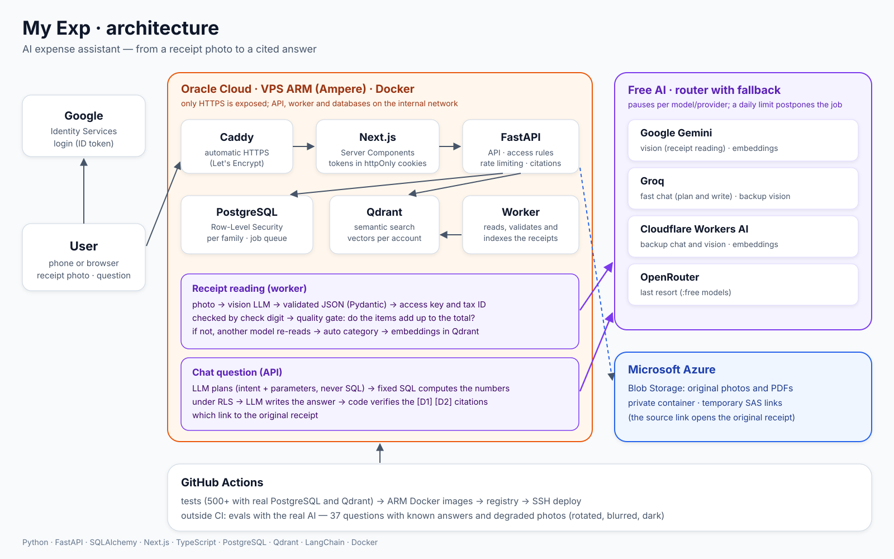

# My Exp

An AI expense assistant for families in Brazil. Snap a photo of a supermarket receipt,
upload a utility bill PDF or an NF-e XML, and then just ask:

> *"Quanto gastei no mercado este mês?"* · *"Onde o tomate está mais barato?"* ·
> *"Tenho alguma conta de luz para pagar?"* · *"Com o que mais gastei em outubro?"*

The assistant answers with the numbers **and links to the documents they came from**.
The product (UI, prompts, documents) is in Brazilian Portuguese; the code and docs are in English.

## What it does

- **Reads Brazilian fiscal documents:** NFC-e receipts and bills from photos/PDFs through
  vision LLMs; NF-e/NFC-e XML deterministically (no AI). The 44-digit access key (with its
  mod-11 check digit) is parsed to confirm the document type and the issuer's CNPJ.
- **Answers questions with citations:** spending by period, store, type or category,
  price history, cheapest place, last purchase, most expensive items, bill comparison,
  overdue bills. Every answer cites `[D1]`, `[D2]`... linking to the original files.
- **Organizes automatically:** categories are assigned by rules + the LLM; the same store
  (by CNPJ) always gets the same name. No forms, no manual registration.
- **Dashboard:** monthly spending, categories, stores, top products, bills due.
- **Family accounts:** closed platform with invitations; each account's data is isolated.

## Architecture



How it runs in production (Oracle Cloud ARM VM, Docker, Caddy, Azure Blob, GitHub Actions):
[docs/deployment.md](docs/deployment.md).

Inside the code:

```
            ┌──────────────────────┐   server-side only   ┌──────────────────────────────┐
browser ───►│ Next.js (App Router) │─────────────────────►│ FastAPI                      │
            │ Server Components +  │  Bearer token from   │ Router → Service → Repository│
            │ Server Actions       │  httpOnly cookies    └──────┬────────┬───────┬──────┘
            └──────────────────────┘                             │        │       │
                                                     PostgreSQL (RLS)  Qdrant   Azure Blob
                                                             ▲
                                     ingestion_jobs queue    │
            ┌────────────────────────────────────────────────┴──┐
            │ Worker: extract (vision LLM / XML) → validate →    │──► LLM router (free tiers:
            │ categorize → persist → index (embeddings)          │    Gemini, Groq, Cloudflare,
            └───────────────────────────────────────────────────┘    OpenRouter)
```

## Engineering decisions worth a look

- **The LLM never writes SQL or does math.** A planner classifies the question into a fixed
  intent + parameters (validated by Pydantic, then normalized by code); fixed, parameterized
  SQL computes the facts; a second call only writes them up. Citations are verified by code,
  and invented references are removed. → `api/app/services/assistant/`
- **Multi-tenancy enforced by the database.** PostgreSQL Row-Level Security (`FORCE`) on every
  domain table; the API and the worker run as roles without `BYPASSRLS`; the worker gets its
  account context only through `SECURITY DEFINER` functions tied to the job it holds. Queries
  still filter by `account_id` — RLS is the last barrier, not the only one. → `api/migrations/`
- **Free-tier AI that keeps working.** A router over several providers with per-model and
  per-provider cooldowns: per-minute limits wait briefly, daily limits pause until the
  provider's reset, and jobs are postponed without spending an attempt when every model is
  exhausted. Separate model lists for vision (worker) and text (chat) so they don't eat each
  other's quota. → `api/app/services/llm_router.py`
- **Quality gate on extraction.** If the items don't add up to the total (taking the printed
  discount into account) or the item count differs from the one printed on the receipt, the
  next model re-reads it. → `api/app/services/extraction/`
- **Opaque session tokens** (SHA-256 stored, rotating refresh tokens with reuse detection and
  a short grace window for parallel requests) instead of JWT, so logout/revocation is immediate.
- **The browser never talks to the API.** Next.js calls FastAPI server-side; tokens live in
  httpOnly cookies; the API has no public port in the Docker deployment.
- **Evaluations with the real AI**, separate from unit tests: 37 assistant questions over a
  fixed dataset, and receipt photos degraded 6 ways (rotated, tilted, dark, blurred...).
  → `api/evals/`

## Tech stack

**Backend:** Python 3.13, FastAPI, SQLAlchemy 2, Pydantic 2, PostgreSQL 16+ (RLS), golang-migrate,
Qdrant, LangChain, Azure Blob Storage, PyJWT (Google ID token validation).
**Frontend:** Next.js 16 (App Router), React, TypeScript, Tailwind CSS 4, openapi-typescript +
openapi-fetch (types generated from the API contract), Vitest.
**AI:** Gemini, Groq, Cloudflare Workers AI and OpenRouter free tiers (chat, vision and embeddings).

## Repository layout

| Folder | What |
|---|---|
| [`api/`](api/README.md) | FastAPI backend + ingestion worker, migrations, tests, evals |
| [`web/`](web) | Next.js frontend |
| [`deploy/`](deploy) | Production configuration examples (Docker Compose, Caddy, environment) |
| [`docs/`](docs) | Deployment guide and architecture diagram |

## Running locally

Prerequisites: Python 3.13, Node 20+, Docker (for PostgreSQL and Qdrant),
[golang-migrate](https://github.com/golang-migrate/migrate), and API keys for at least one AI
provider (free tiers are enough) and an Azure Storage account.

```bash
# 1. backend
cd api
python -m venv .venv && source .venv/bin/activate    # Windows: .venv\Scripts\activate
pip install -r requirements-dev.txt
cp .env.example .env                                  # fill in the values
# create the database and apply the migrations (see api/README.md)

# 2. frontend
cd ../web && npm install && cp .env.example .env.local

# 3. one terminal each, from the repository root
make api      # http://127.0.0.1:8000/docs
make worker   # processes uploaded documents
make web      # http://localhost:3100  (development login: e-mail only)
```

`make types` regenerates the frontend types from the API; `make test` runs every test.

## Tests

- **API:** unit + integration tests against a real PostgreSQL and Qdrant (`api/README.md`).
- **Web:** type checking, ESLint and Vitest.
- **CI:** GitHub Actions runs all of the above on every push (`.github/workflows/ci.yml`).

## License

[MIT](LICENSE)
