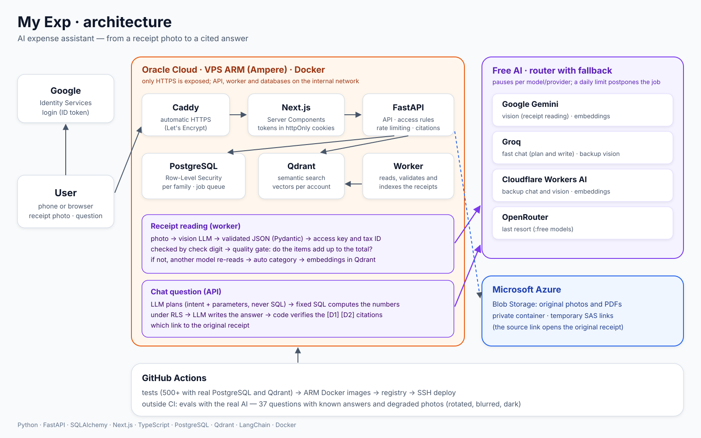

# Deployment

How My Exp runs in production: one small ARM virtual machine with Docker, a managed
blob storage and free AI tiers. The files in [`deploy/`](../deploy) are the real
configuration, with names and domains replaced by placeholders.



## Topology

| Where | What |
|---|---|
| **Oracle Cloud** (Always Free ARM VM, Ampere) | Docker with one shared network (`app-network`): Caddy, the frontend, the API, the worker, PostgreSQL and Qdrant |
| **Microsoft Azure** | Blob Storage for the original photos, PDFs and XMLs (private container, short-lived SAS links) |
| **Google** | Identity Services: sign-in with a Google ID token, validated by the API |
| **AI providers** | Gemini, Groq, Cloudflare Workers AI and OpenRouter free tiers, behind the API's router with fallback |
| **GitHub Actions** | Tests, ARM images, deployment over SSH |

Only Caddy publishes ports (80 and 443). Everything else talks over the internal Docker
network by container name:

```
internet ──443──► Caddy ──► web:3000 (Next.js) ──► api:8000 (FastAPI) ──► PostgreSQL, Qdrant
                                                        worker ──────────► PostgreSQL, Qdrant
                                          api / worker ──HTTPS──► Azure Blob, AI providers
```

The browser never calls the API: Next.js Server Components and Server Actions call it
server-side, and the session tokens live in httpOnly cookies. That is also why the API needs
no public port.

## Containers

| Container | Image | Limits | Notes |
|---|---|---|---|
| `caddy` | `caddy:2-alpine` | 128 MB · 0.25 CPU | Automatic HTTPS (Let's Encrypt), HTTP/3. Shared by every app on the server |
| `myexp-web` | `web/Dockerfile` | 384 MB · 0.5 CPU | Next.js standalone output. Receives only `API_URL` and `GOOGLE_CLIENT_ID` |
| `myexp-api` | `api/Dockerfile` | 768 MB · 0.5 CPU | Health check on `/health`; the frontend waits for it |
| `myexp-worker` | same image as the API | 768 MB · 0.5 CPU | `python -m worker`: extraction, validation and indexing of uploaded documents |
| PostgreSQL | `postgres:16` | shared | One database per app; reached as `DB_HOST=<container>` |
| Qdrant | `qdrant/qdrant` | 512 MB | Vectors per account (`QDRANT_API_KEY` if enabled) |

The API and the worker share one image, so a backend change is one build.

Files: [`deploy/docker-compose.yml`](../deploy/docker-compose.yml) (app),
[`deploy/caddy-compose.yml`](../deploy/caddy-compose.yml) and
[`deploy/Caddyfile`](../deploy/Caddyfile) (proxy), [`deploy/env.example`](../deploy/env.example)
(configuration).

## Database

- **Roles:** migrations run as the schema owner; the API connects as `myexp_app` and the worker
  as `myexp_worker`, both without `BYPASSRLS`, so row-level security always applies.
- **Migrations** (golang-migrate) are applied from a workstation with the owner role,
  **before** pushing code that depends on them. The deploy never migrates on its own, so a
  schema change is a deliberate step:

  ```bash
  migrate -path api/migrations -database "postgres://<owner>:<password>@<host>:5432/myexp?sslmode=disable" up
  ```

- Migrations are written to be safe on existing data. For example,
  `000002_dedup_and_review` backfills the access key only on the oldest copy of a receipt
  that was already uploaded twice, so the unique index can be created.

## CI/CD

One pipeline per app (API + worker, frontend), triggered only by changes in its folder:

1. **Tests:** API unit and integration tests against real PostgreSQL and Qdrant service
   containers; frontend type checking, ESLint and Vitest.
2. **Build:** `docker buildx` for `linux/arm64` under QEMU, with the GitHub Actions cache.
   Node crashes under QEMU ("Illegal instruction"), so `npm ci` and `next build` run on
   `$BUILDPLATFORM` (native x86); only the small runtime stage is ARM.
3. **Push:** `:latest` (used by the compose file) and `:<commit sha>` (for rollbacks).
4. **Deploy:** SSH into the server, `docker compose pull` and `up -d` **only for that app's
   services**; the other app keeps running.

A one-at-a-time concurrency group keeps two quick pushes from overlapping.
[`deploy/deploy-workflow.example.yml`](../deploy/deploy-workflow.example.yml) shows the
pipeline; it is not active here (this repository's CI only runs the tests).

Evaluations with the real AI (`api/evals`) run outside CI, before changes to the assistant or
the extraction go out: they spend free quota and take minutes.

## First deployment

1. Create the network once: `docker network create app-network`. Run PostgreSQL and Qdrant on it.
2. Create the database and the roles, then apply the migrations (see above) and set the
   passwords of `myexp_app` and `myexp_worker`.
3. Copy `deploy/docker-compose.yml` and `deploy/env.example` (as `.env`, `chmod 600`) to the
   server and fill in the values. The `.env` must be readable by the user that runs the deploy.
4. Point a DNS name at the server, put it in the `Caddyfile` and start Caddy. The certificate
   is issued on the first request.
5. Open ports 80 and 443 in the cloud firewall (security list) **and** in the VM firewall.
6. `docker compose up -d`.

## Operations

```bash
docker compose logs -f api worker     # logs
docker compose ps                     # health
# roll back: pin the previous :<sha> tag in docker-compose.yml, then
docker compose up -d api worker
```

To debug a problem that only shows up with real data, take a `pg_dump` of the production
database and restore it into a disposable local PostgreSQL. The AI can then replay the real
conversations against the copy, inside a transaction that is rolled back. That is how the
fixes for abbreviated product names were found.

## Lessons learned

- **Container names, not `localhost`.** Inside the Docker network, `QDRANT_URL` is
  `http://<qdrant-container>:6333`; `127.0.0.1` points at the container itself.
- **The frontend needs its own variables.** `GOOGLE_CLIENT_ID` goes to the web container
  explicitly; it does not read the API's `.env`, on purpose, so no API secret reaches it.
- **File permissions matter for the deploy user.** A `.env` created with `sudo` cannot be read
  by `docker compose` running as the SSH user.
- **ARM builds:** build anything Node-heavy natively and copy the result into the ARM image.
